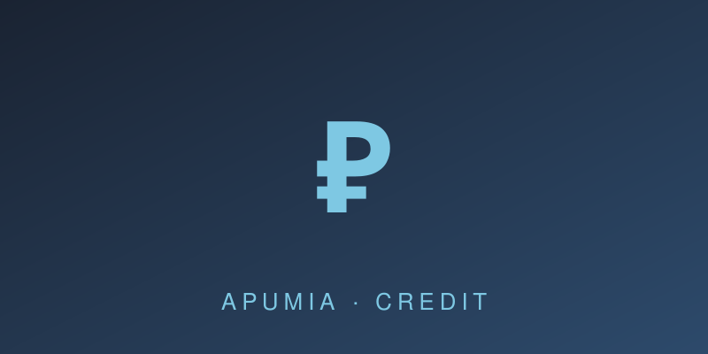

# Apumia Credit

**8/8 инвариантов. Кредитный скоринг с проверяемым доказательством.**

---

## За 30 секунд

**Что это:** Кредитный скоринг с проверяемым доказательством. 8 инвариантов, каждый проверяется независимо.

**Кому:** Банки и финтехи — скоринг с аудитом.

**Почему сейчас:** Регулятор спрашивает «как модель решила». Apumia Credit даёт 8 инвариантов, которые регулятор проверяет сам.

**Что доказано:** 8/8 инвариантов PASS.

**Чего не доказано (честно):** В работе.

---

## Оффер

По запросу.

**Следующий шаг:** Покажу 8 инвариантов — 20 минут.

---

## GitHub

- **Private code:** apumiaaifund/apumia_credit
- **Public demo:** apumiaaifund/apumia-credit-demo

## License

MIT

---

### 🚀 Что мы можем реализовать для партнёров на основе этого решения (Ниши и сценарии)

- **Банки, МФО и B2B-факторинг:** детерминированный контроль лимитов и объяснимость решений поверх скоринговых ML-моделей.
- **Регуляторная отчётность:** готовый крипто-след по каждому одобренному или отклонённому кредитному кейсу.

> **Формат сотрудничества:** запуск пилотного стенда (PoC) за 2–4 недели, лицензирование модуля (On-Premise) или кастомная интеграция под стек заказчика.  
> 📬 **Запросить демонстрацию и расчёт пилота:** [apumiaaifund@gmail.com](mailto:apumiaaifund@gmail.com)

---

### 🛡️ Верификация качества и безопасности (Apumia DevSecOps Gate)

> **Статус:** `VERIFIED & PROVEN` • **Дата аудита:** `16.11.2026`  
> **Контроль архитектуры (`Apumia Blueprint`):** `CLEAN` (`0` циклических зависимостей, контроль сложности McCabe)  
> **Анализ безопасности (`Bandit / Zero-Trust`):** `0` критических уязвимостей  
> **Протокол достоверности (`Apumia Hub`):** `_synthetic: false` | `preservation: 100.0%` | `verified: true`
